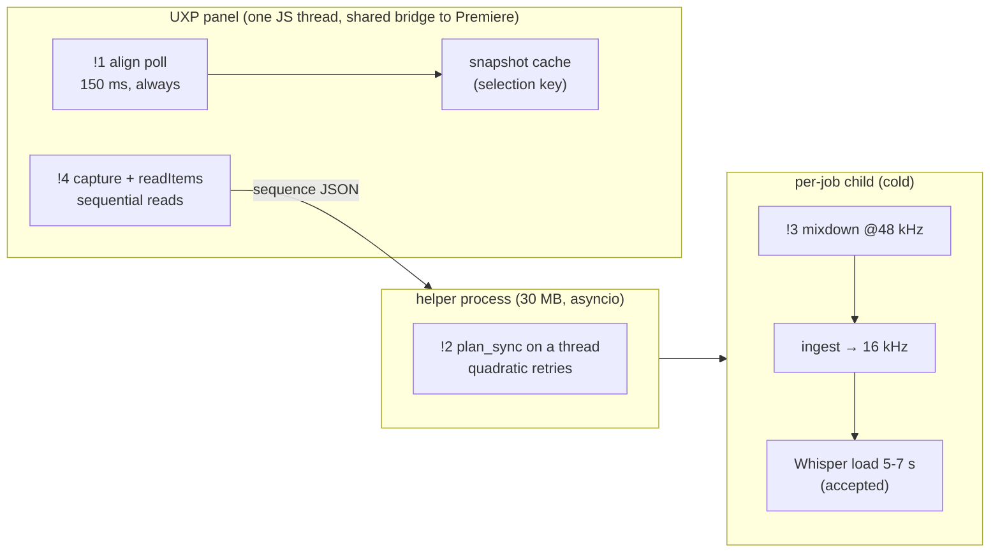

# Architecture & Design: where CutDeck spends time and memory it doesn't need to

Date: 2026-10-13. Scope: the panel (`uxp/cutdeck/`), the helper (`cutdeck/xml_bridge.py`) and
the processes it starts (`cutdeck.xml_recut`, `cutdeck.ai_worker`), Sync (`cutdeck/sync_plan.py`),
the mixdown (`cutdeck/xml_audio_extract.py`). Follows `docs/arch-design-helper-v3.md`; its four
moves have landed (`driver_commands.py`, transcript reuse by mixdown sha256, `sequence_model.py`,
`sequence.json` jobs), and its decisions stand. This doc changes no code.

*Labels: **proven** = measured this session (scripts in the session scratchpad, numbers below)
· **traced** = read the whole chain · **suspected** = neither.*

## Verdict

**The shape is sound; the waste is in four loops, not in the architecture.** The helper is lean
at rest (30 MB RSS, 0.16 s import, proven), runs CPU work on a thread without stalling its
socket (numpy releases the GIL: 2 ms worst event-loop stall during 1.6 s of FFTs, proven), and
spawns a GPU child only per job. Where time and memory actually go, in order of what you feel:

| # | Cost | Where | Measured | Badge |
|---|---|---|---|---|
| !1 | Transform panel polls Premiere every 150 ms forever, though the design (Slice 3) says 1000 ms when idle; and since Slice 2's cache, each poll can't see what the heartbeat exists for | `features/align.js:150-159`, `transform/snapshot.js:88` | **67** reads per 10 s idle vs **10** designed (proven); ~4-6 bridge calls each (traced) → ~40 host calls/s competing with your clicks | Strong |
| !2 | Sync is quadratic in clips that don't match, and re-FFTs the whole session audio for every 60 s piece tried | `sync_plan.py:150-160, 235-245`; `sync.py:131-139` | synthetic 3-cam 30-min shoot: 0 b-roll **0.8 s**; 4 → **11 s**; 8 → **26 s**; 16 → **51 s** (462 correlations, ~0.1-0.17 s each) (proven) | Strong |
| !3 | Mixdown built at 48 kHz, then decoded back to 16 kHz: 3× the memory for no output difference in rate | `xml_audio_extract.py:39, 88`; `sync.py:88-94` | per 10 min of sequence: buffer 110 MB vs 37 MB, decode peak **225 MB vs 73 MB** (proven); a 1-hour sequence ≈ 1.3 GB vs 0.45 GB peak (extrapolated); decode *time* is the same (0.14 s vs 0.03 s) | Strong (memory only) |
| !4 | Rough Cut reads the source timeline twice, one awaited call at a time, ~7-10 bridge calls per clip | `workflow.js:40-57` (capture), `nativeCut.js:33-55` (`readItems`), `nativeSync.js:88-103` (`mediaInfo` loop) | call counts traced; wall time not measured live. `listClips` in the same file already reads a track's clips with `Promise.all` | Worth exploring (measure first) |
| — | Every ASR job is a cold Python child: imports + Whisper load before the first word | `xml_bridge.py:465-482, 527` | **7-10 s** per job (imports 1.6 s, Silero 0.3-0.9 s, first decode 2.3 s, CT2 model 5.3-7.3 s), proven | Accepted: see Decisions |

Not a cost (checked, clean): helper idle footprint; helper responsiveness during Sync; the
DeepFilterNet denoise in the silence-only path (`df` isn't installed, and the default preset runs
with ASR, which skips denoise); ClubFriday polling (1.5-2 s, only while a job runs); disk
(`transcriber.db` 9.9 MB with rough-cut transcripts now kept).

## Concept map

## Decisions

| Decision | Options | Forces | Door | Evidence |
|---|---|---|---|---|
| Poll: what the heartbeat is for | A: timer honours `currentPollInterval()` and a heartbeat refreshes only the primary clip's Motion values (cheap, sees Effect Controls drags); B: drop the heartbeat, events only | Slice 3 plan says Effect Controls drags fire no event, so the heartbeat is the only way to see them; today the Slice-2 cache returns the old transform on every hit, so the heartbeat sees nothing it was kept for | two-way | traced: `snapshot.js:88` returns `cachedSnapshot` before `readTransform`; only `apply.js:54` clears it |
| Sync: cut the retries | **A: when a session grows by clip C, a clip that failed before is retried against C's audio only, plus cache the session's FFT per (session version, n_fft)**; B: memoize failed pairs symmetrically | A keeps the algorithm's answers (a clip can only newly match through the newcomer); B also kills the b-roll×b-roll term but X-in-Y and Y-in-X aren't the same computation | A two-way; B changes results at the margin | proven: correlation counts above |
| Mixdown rate | **A: extract at 16 kHz** (ingest's rate); B: keep 48 kHz | the analysis was tuned on 48→16 kHz via soxr; ffmpeg's resampler at 16 kHz may move VAD edges by a frame | two-way; one-time transcript-cache miss (new sha256) | proven: memory table |
| Warm GPU worker for ASR | A: keep a model loaded; **B: keep cold children** | saves 7-10 s/job, but holds ~1.5 GB of an 8 GB RTX 3070 that Premiere also uses, and v3 ruled it out | — | CLAUDE.md VRAM rule; `arch-design-helper-v3.md` Context |

## Moves

### 1. Make the Transform poll adaptive for real, and make the heartbeat see something
cost:   67 snapshot reads / 10 s idle (designed 10); each ~4-6 bridge calls; and the heartbeat can't
        show an Effect Controls drag because the cache hides it
pays:   ~85 % fewer idle host calls; the click no longer queues behind a poll
files:  `uxp/cutdeck/features/align.js`: replace `setInterval(…, FAST_POLL_MS)` with a
        self-rescheduling `setTimeout(tick, currentPollInterval())`. On an idle tick with an
        unchanged selection signature, re-read only `snap.clips[0]`'s Motion values (or call
        `readSnapshot({forceRefresh:true})` on idle ticks only, the simpler first cut)
proof:  extend the existing Slice-3 test (`tests/cutdeck_align_panel.test.cjs:935`) to drive the
        *timer*, not the helper: 10 s of fake idle time → ≤ 11 reads (fails today at 67, the
        scratch harness `poll_count.cjs` reproduces it). New test: an external Motion change with
        the same selection appears within one idle tick. `node --test tests/*.cjs` green.
        Live: Effect Controls drag shows in the panel within ~1 s
effort: S

### 2. Sync: retry against the newcomer only; cache the session FFT
cost:   51 s for 3 cameras + 16 unmatched clips (synthetic), almost all of it re-testing clips
        that already failed against a session that only grew elsewhere
pays:   expected: unmatched clips cost ~one pass each instead of one per session growth
files:  `cutdeck/sync_plan.py` (`plan_sync`'s `while grew` loop, `_try_place`, `_composite`);
        `cutdeck/sync.py` gains an optional precomputed reference spectrum
proof:  existing Sync tests green, placements identical (`python -m pytest tests -k sync -q`);
        the synthetic bench (`syncbench.py 16`) drops from 462 correlations / 51 s, and its plan
        equals today's plan clip for clip
effort: M

### 3. Build the mixdown at 16 kHz and stop copying each segment
cost:   3× memory per mixdown (225 → 73 MB decode peak per 10 min); `extract_mono_audio` holds
        ffmpeg's bytes and a `.copy()` of them at once
pays:   ~1 GB less peak on a 1-hour sequence; nothing on time
files:  `cutdeck/xml_audio_extract.py:39` (`_WORKING_SAMPLE_RATE = 16000`);
        `cutdeck/sync.py:94` (`np.frombuffer` without `.copy()` where no caller writes into it —
        check `sync_plan._unit` and the mixdown paste first)
proof:  the rough-cut golden/reliability set (`.verify-evidence/rough-cut-reliability`) gives
        the same cut frames, or differences ≤ 1 frame that you accept; Python tests green.
        If cuts move more, stop and keep 48 kHz
effort: S

### 4. Measure Rough Cut's two timeline reads, then parallelise per track
cost:   traced ~7-10 awaited bridge calls per clip, twice per Rough Cut (`capture` and
        `readItems`), each in a strict `for … await` loop
pays:   unknown until measured; `nativeCut.js` already has `timed()`
files:  first only add `timed("capture")` / `timed("read source")` and run one live Rough Cut on
        a real project. If either is > 2 s, read each track's items with `Promise.all` as
        `listClips` does (`nativeSync.js:35`), and reuse `getProjectItem` between `mediaInfo` and
        the speed/nested checks in `readItems`
proof:  `node --test tests/*.cjs` green, `node tools/adobe/check-api.mjs` clean; the live timing
        row added to `docs/PREMIERE_FACTS.md`
effort: S to measure, S-M to fix

Order: 1 and 3 are independent and small; 2 is the largest time win for multi-cam days; 4 waits
on a live measurement.

## Status (2026-10-13)

Written against a tree 49 commits behind master. Master had already landed its own idle poll
(`align.js` skips ticks until `IDLE_POLL_MS`) and a 16 kHz mixdown (`extract_mixdown(sample_rate=16000)`,
read straight from ffmpeg). On merge, master's versions were kept and only what they lacked was added.

| Move | Landed | Notes |
|---|---|---|
| 1 poll | master's skip-ticks poll, plus a fresh (cache-bypassing) read on idle ticks | idle ticks used to return the cached snapshot, so an Effect Controls edit never showed; new test fails without the change |
| 2 sync | this change | refused clips retry only against members that joined since; reference FFT cached. 4 unmatched clips: 48 -> 36 correlations, 7.0 -> 3.0 s; 8: 138 -> 114, 13.5 -> 5.6 s; 16: 462 -> 414, ~51 -> 13 s. Plans identical (4, 8). Peak memory +~60 MB |
| 3 mixdown | master | Measured here: 16 kHz straight from ffmpeg (no libsoxr in this build) vs 48 kHz-then-soxr moved cut edges on 1 of 3 real ranges by up to 92 ms (2 identical), but the planner's own noise is larger (a 7 ms input shift changed 126 -> 133 cuts), so it is not a reason to revert. Resampling each 48 kHz segment with librosa would match today's output more closely if exactness ever matters |
| 4 reads | this change | per-clip host reads in `readAudioTracks` and `readItems` run together (as `listClips` does). **Speed gain not measured: Premiere was not running.** |

Still open: Sync's b-roll x b-roll term (each unmatched clip becomes an anchor and is tried against
the rest); a live timing of Rough Cut's two reads.
