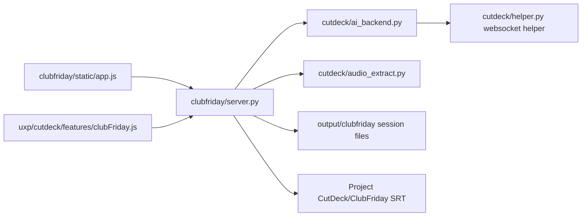

<!-- context-paths: clubfriday/server.py, clubfriday/static/app.js, cutdeck/ai_backend.py, cutdeck/audio_extract.py, uxp/cutdeck/main.js -->
# Architecture

Rough Cut's current native analysis/edit flow and recovery rules are mapped in
[Rough Cut](rough-cut.md), traced and tested offline on 2026-10-11. The historical
native-cut handoff includes superseded XML input and split designs.
The shared helper, analysis, extraction and timing now have independent modules;
FCP7 input/output is retired. New cut plans validate source audio before native edits.

## ClubFriday path

ClubFriday owns quote sessions and exports; the shared CutDeck helper owns ASR jobs.
This as-is module view was traced on 2026-10-11.

| Arrow | Source evidence |
|---|---|
| Browser -> server | clubfriday/static/app.js:7, 135, 143, 153: fetch/save/export |
| Server -> backend | clubfriday/server.py:139, 230: submit job and poll result |
| Server -> audio | clubfriday/server.py:74: extract_mixdown with zero padding |
| Server -> sessions | clubfriday/server.py:111: atomic write_json persistence |
| Server -> SRT | clubfriday/server.py:289, 306: BOM/CRLF writes |
| Backend -> helper | cutdeck/ai_backend.py:54: localhost websocket exchange |
| Panel -> server | uxp/cutdeck/features/clubFriday.js:7: HTTP request |

## Boundaries and placement
- clubfriday/: API/UI, session lifecycle, timeline offset, quote rules and exports.
- cutdeck/: shared sequence model, source-audio extraction and helper client/jobs.
- uxp/cutdeck/: Premiere bindings/imports; Adobe API rules remain in CLAUDE.md.
- tests/test_clubfriday.py uses fake helper/extractor and temp project/session files.
- Browser assets belong in clubfriday/static; tests in tests; shared helper behavior
  in cutdeck. Generated audio/session/evidence belongs under ignored output/.
- Source extraction uses ffmpeg, numpy and soundfile; it omits Premiere effects,
  transitions and gain automation (cutdeck/audio_extract.py module contract).

## Coverage gaps
- Helper -> ASR engines -> SQLite is outside this traced flow; consult SYSTEM_SPEC.md
  and features/transcribe.md, then read the actual chain before changing it.
- Editor :8000, CLI jobs, evaluation, MCP and other panel workflows are inventoried
  in FEATURES.md but not fully traced here. No hosted CI directory was present.
- Mermaid syntax inspected; renderer not run. Whole-system wiring remains partial.
