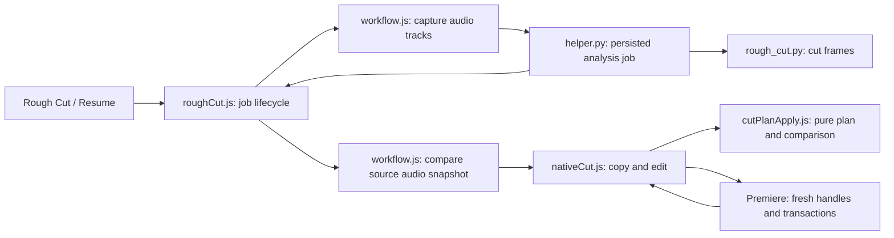

# Rough Cut: current design and recovery

Current owner request (2026-10-11): improve reliability when Rough Cut stops midway
and leaves a failed sequence; leave enough context to recover the design next time.
Follow-up owner authorization: retire XML-file routes, separate shared services,
and improve the native path. This is a local source change; live confirmation is pending.

## Requirements
- Analyze the marked range; apply cuts to a copy, preserving the source sequence.
- Recover stale Premiere handles by reading fresh handles, including the first
  action of a split/move batch and the first action after a partial commit.
- Allow at most three fresh-read retries without progress; then report the stage
  and action, mark the copy FAILED, and prevent Resume from duplicating that copy.
- Only announce success after clip-by-clip read-back matches the pure cut plan.
- Newly analysed cuts carry source audio data; changed media, timing, speed, enabled state,
  track state or sequence duration must refuse before creating a copy.

## Current flow (source-traced)

| Edge / responsibility | Source |
|---|---|
| Button routing and feature construction | uxp/cutdeck/main.js:71,165-169 |
| Capture, persisted job and Resume | uxp/cutdeck/features/roughCut.js:90,151,180 |
| Native audio input; prepare/start | uxp/cutdeck/workflow.js:40,63 |
| Compare source audio before any copy/edit | uxp/cutdeck/workflow.js:84 |
| Persist sequence.json; launch analysis; return cuts | cutdeck/helper.py:277,440 |
| Pure cut plan and verification | uxp/cutdeck/timeline/cutPlanApply.js:132,163 |
| Native edit entry point (panel and agent calls) | uxp/cutdeck/timeline/nativeCut.js:294; uxp/cutdeck/features/driver.js:105 |
| Transactions owned in one place | uxp/cutdeck/host/project.js:26 |

## Failure and repair
Recorded live failures: stale move handles on 2026-10-01/06 and stale razor handles
on 2026-10-10 (nativeCut.js comments; git commits 6c1e185 and earlier).
The old recovery condition required an earlier action in the batch. At action 1,
it threw immediately; the copy was marked FAILED. This case is reproduced offline.
Both split and move loops now abort the empty transaction, reread, and retry the
same pending action. Partial batches still advance by the committed count.
Retries stop after three fresh reads without progress; progress resets the budget.
Other errors remain failures. No new Adobe API, queue, datastore or plugin seam.

The alternative was shrinking all 3,000-action batches. That may reduce handle age,
but does not repair a stale first action and adds transactions/reads to every run.
The chosen change keeps the existing batch sizes and adds bounded recovery.
This is reversible code, without a stored-data or public-API migration.

## Verification and remaining work
- Recipe: verification/rough-cut.md; tests use an exact XML-recut golden fixture.
- Includes first-action/mid-batch recovery, persistent failure, source preservation,
  432-cut/5-track scale, refusal, job persistence and failed-copy handling.
- Live Premiere remains required: offline fakes cannot prove host commit semantics.
- New cuts include source_sequence: native apply rereads audio and compares a canonical
  signature before cloning. Enumeration order is ignored; both panel and agent use this guard.
- Stale-source errors discard the panel result so a new cut reanalyses. Wrong sequence identity
  stays resumable. Older saved JSON results without snapshots retain the old checks.
- Filler setup/removal errors and commit failures are not automatically retried.
- Native razor is announced for 27.1 but unproven here (PREMIERE_FACTS.md:205).
  Replacing overwrite-as-razor requires an installed-host probe first.
- Historical HANDOFF_CUTDECK_NATIVE_ROUGH_CUT.md describes retired XML input and
  earlier split proposals; use this current map and workflow.js for today's flow.

## XML retirement
The helper is `python -m cutdeck.helper`; analysis is `cutdeck/rough_cut.py`,
source extraction is `cutdeck/audio_extract.py`, and tick/frame/window math lives in
`cutdeck/sequence_timing.py`. `sequence_model.py` validates JSON only.
The XML-file MCP `rough_cut` tool and helper submit route are retired; use
`premiere_rough_cut`, then `premiere_apply_cuts`. Prepared/ready XML jobs fail with a
replacement message. JSON jobs retain their persisted format. Protocol version is cutdeck-6.

`cutdeck.xml_bridge` is a compatibility launcher; `cutdeck.xml_recut` and cut_xml.ps1
are retirement messages. Production contains no FCP7 parser or rewrite engine.
The panel's installed manifest ID and saved-job key retain their historical names
to preserve installation and recovery identity; they do not select an XML route.
Historical XML fixtures are read only by tests/sequence_fixture.py; native output
remains checked against the frozen native golden. Project-file XML for .prproj
inspection, adjustment layers and color mattes remains a separate supported workflow.

Verification contract: verification/rough-cut-retirement.md; command:
`python scripts/check_rough_cut.py`. Reload the panel and restart the helper after this change.

## Sound guard: cut silence only (2026-10-12)
Problem: silence was whatever Silero VAD and the RMS gate did not call speech, so a held
vowel ("ahhhh") that scored as non-speech was cut, and a short island of real sound could be
dropped by the min-clip merge.
- `ingest.sound_runs` judges by loudness alone: a window 15 dB above the file's own noise
  floor (5th-percentile level, clamped to -65..-35 dB) seeds a run; the run grows while it stays
  6 dB above the floor (fading tails) and needs 100 ms of seed (clicks do not count).
  It reads the pre-denoise audio.
- `ingest(sound_guard_db=...)` unions those runs into the speech segments; the runs also
  travel on `IngestResult.sound_runs` into `build_cut_spans(protect=...)`, so
  `apply_min_clip_merge` never drops an island that overlaps one.
- Config: `cut.sound_guard_db/tail_db/min_ms` (config.yaml, on by default; null disables).
  `cutdeck.rough_cut.analysis_ingest_kwargs` is the single mapping used by analysis.
- The aggressive overlay uses 150 ms VAD/gate/silence thresholds and 60/40 ms pads, which are
  only safe because of the guard. Measured on 120 s of real audio: 10.6 s removed vs 5.2 s for
  standard, 0 audible 20 ms windows inside cuts. Aggressive is the default everywhere (panel, helper, MCP); standard stays selectable.
- Check: `python -m pytest tests/test_cutdeck_sound_guard.py` (synthetic held vowel, VAD blind
  to it, both presets; fails with the guard off). Not yet heard in live Premiere.
