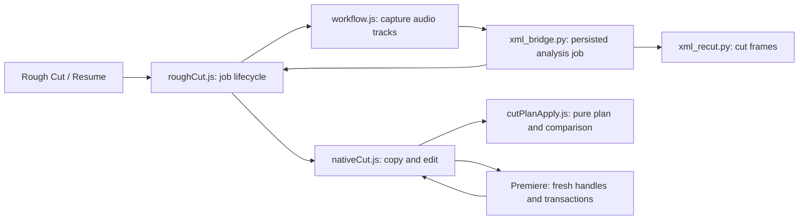

# Rough Cut: current design and recovery

Current owner request (2026-10-11): improve reliability when Rough Cut stops midway
and leaves a failed sequence; leave enough context to recover the design next time.
The system is messy in its host recovery, but its helper/panel boundary is sound.

## Requirements
- Analyze the marked range; apply cuts to a copy, preserving the source sequence.
- Recover stale Premiere handles by reading fresh handles, including the first
  action of a split/move batch and the first action after a partial commit.
- Allow at most three fresh-read retries without progress; then report the stage
  and action, mark the copy FAILED, and prevent Resume from duplicating that copy.
- Only announce success after clip-by-clip read-back matches the pure cut plan.

## Current flow (source-traced)

| Edge / responsibility | Source |
|---|---|
| Button routing and feature construction | uxp/cutdeck/main.js:71,165-169 |
| Capture, persisted job and Resume | uxp/cutdeck/features/roughCut.js:90,151,180 |
| Native audio input; prepare/start | uxp/cutdeck/workflow.js:43,68 |
| Persist sequence.json; launch analysis; return cuts | cutdeck/xml_bridge.py:299,472 |
| Pure cut plan and verification | uxp/cutdeck/timeline/cutPlanApply.js:132,163 |
| Native edit entry point (panel and agent calls) | uxp/cutdeck/timeline/nativeCut.js:294; uxp/cutdeck/features/driver.js:117 |
| Transactions owned in one place | uxp/cutdeck/host/project.js:26 |

## Failure and repair
Recorded live failures: stale move handles on 2026-10-01/06 and stale razor handles
on 2026-10-10 (nativeCut.js comments; git commits 6c1e185 and earlier).
The old recovery condition required an earlier action in the batch. At action 1,
it threw immediately; the copy was marked FAILED. This case is reproduced offline.
Both split and move loops now abort the empty transaction, reread, and retry the
same pending action. Partial batches still advance by the committed count.
Retries stop after three fresh reads without progress; progress resets the budget.
Other errors remain failures. No new Adobe API, queue, datastore or plugin seam.

The alternative was shrinking all 3,000-action batches. That may reduce handle age,
but does not repair a stale first action and adds transactions/reads to every run.
The chosen change keeps the existing batch sizes and adds bounded recovery.
This is reversible code, without a stored-data or public-API migration.

## Verification and remaining work
- Recipe: verification/rough-cut.md; tests use an exact XML-recut golden fixture.
- Includes first-action/mid-batch recovery, persistent failure, source preservation,
  432-cut/5-track scale, refusal, job persistence and failed-copy handling.
- Live Premiere remains required: offline fakes cannot prove host commit semantics.
- Source edits during analysis are not fingerprinted; sequence identity is checked.
- Filler setup/removal errors and commit failures are not automatically retried.
- Native razor is announced for 27.1 but unproven here (PREMIERE_FACTS.md:205).
  Replacing overwrite-as-razor requires an installed-host probe first.
- Historical HANDOFF_CUTDECK_NATIVE_ROUGH_CUT.md describes retired XML input and
  earlier split proposals; use this current map and workflow.js for today's flow.
