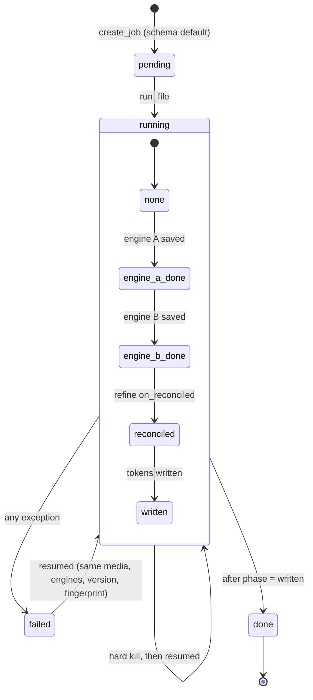
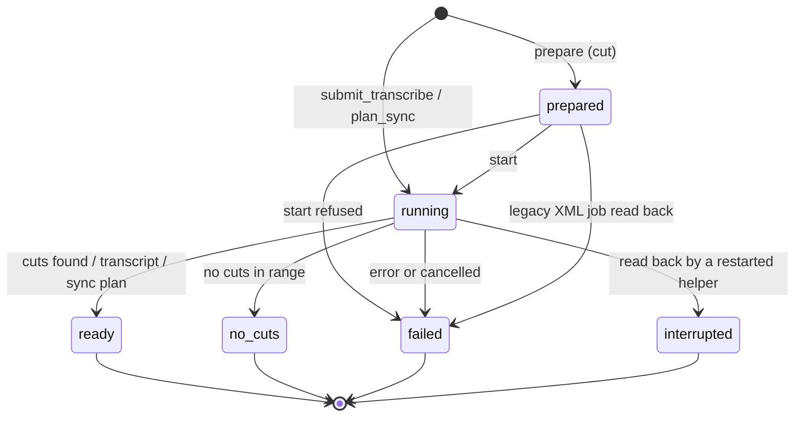
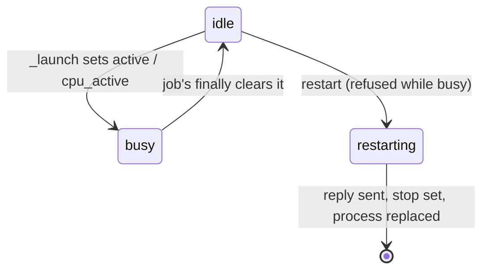
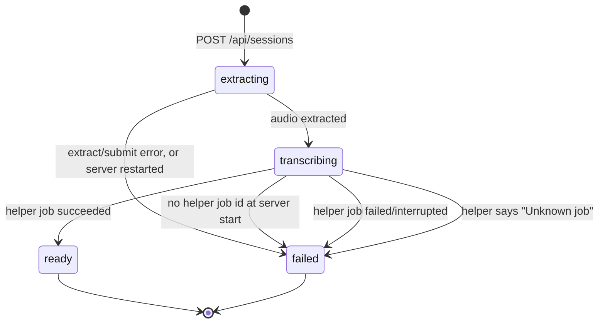
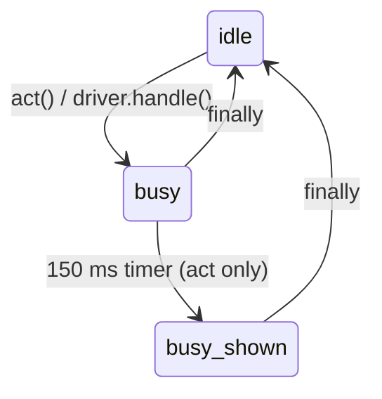
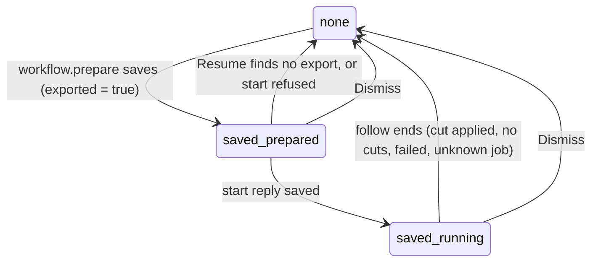

# State machines

The status fields and flags in this repo that behave as state machines, with every write and
check accounted for by `file:line`. Both bugs found are fixed;
[tests/test_state_machine_bugs.py](../tests/test_state_machine_bugs.py) failed on the code before
each fix. Surveyed 2026-11-09 at `77e5cbd`.

## 1. Pipeline job: `job.status` + `job.job_phase`

Two columns, one machine: `status` is the run's liveness, `job_phase` the last persisted phase.
A crash leaves `failed` (exception) or `running` (hard kill); either is resumed from its phase.

| Move | Where |
|---|---|
| insert, `status` default `pending`, phase NULL | `transcribe/db/schema.sql:20`, `transcribe/db/store.py:395` |
| → `running` (new or resumed job) | `transcribe/pipeline/run.py:157` |
| phase → `engine_a_done` | `transcribe/pipeline/engine_run.py:209`, `:238` (after `save_engine_result`) |
| phase → `engine_b_done` | `transcribe/pipeline/engine_run.py:285` |
| phase → `reconciled` | `transcribe/pipeline/run.py:264` via `transcribe/pipeline/refine.py:67-68` |
| phase → `written`, then `done` | `transcribe/pipeline/run.py:297-298` |
| → `failed` | `transcribe/pipeline/run.py:303` |
| Checks | `store.py:443` resume picks `failed`/`running`; `store.py:466` reuse needs `done` + `written`; `run.py:150` → `plan.py:130-133` skip flags; `transcribe/editor/server.py:55,81` display only |

Final: `done`. `pending` lasts only between `create_job` and `run.py:157`. Phases only move
forward: a resumed job skips the engine passes, so `engine_*_done` is never rewritten after a
later phase. No bugs found.

## 2. CutDeck helper job: `job["state"]` (in memory and `output/premiere/<id>/job.json`)

| Move | Where |
|---|---|
| → `prepared` | `cutdeck/helper.py:299` |
| → `running` | `helper.py:315` (transcribe), `:323` (plan_sync), `:346` (`_start`, guarded at `:229-231`) |
| → `failed` | `helper.py:238` (start refused), `:364` (legacy XML on load), `:509,:517,:544,:551,:571,:575` |
| → `ready` / `no_cuts` | `helper.py:504`, `:539`, `:569` |
| `running` → `interrupted` on load | `helper.py:367-368` (a non-move: reading a dead helper's file) |
| Terminal set | `helper.py:36`, `uxp/cutdeck/core/rpc.js:32` (same four) |
| Checks | `helper.py:229,275,405`; `cutdeck/ai_backend.py:22,75,110`; `cutdeck/driver_commands.py:45`; `uxp/cutdeck/features/roughCut.js:83,86,89,94,99,174`; `uxp/cutdeck/timeline/nativeSync.js:104,106,108` |

Every value set is checked, every value checked is set, and `MCP_STATE` maps all six.

### 2b. Helper lanes and restart: `active`, `cpu_active`, `restarting`

Writes: `helper.py:190-192` (init), `:389-392` (`_launch` sets the lane), `:520`, `:554`,
`:578` (cleared), `:254` (`restarting`). Checks: `:231`, `:251` (restart guard), `:376-379`
(`_allocate`), `:604`.

**Bug (fixed):** `restart` refuses while a job runs, so `restarting` with an active lane should be
impossible. But `_allocate` and `start` never check `restarting`: a `submit_transcribe`,
`prepare`/`start` or `plan_sync` that arrives after the restart reply is launched, and the helper
then exits, cancelling it ("Helper stopped during processing"). Fix: `_allocate` and `start`
now refuse while `restarting`. Proof:
`test_helper_refuses_new_job_once_it_agreed_to_restart`.

## 3. ClubFriday session: `session["state"]` (`output/clubfriday/<id>/session.json`)

| Move | Where |
|---|---|
| → `extracting` | `clubfriday/server.py:270` |
| → `transcribing` | `server.py:196` (saved at `:202` with `helper_job_id`) |
| → `ready` | `server.py:299` |
| → `failed` | `server.py:200`, `:210` (startup sweep), `:301` |
| Checks | `server.py:209,286,289,300,320,343,359`; `clubfriday/static/app.js:36,43,51,52,53,55,60,61` |

**Bug (fixed):** `get_session` (`server.py:303-305`) treats every `RuntimeError` or `ValueError`
from the helper as a passing connection problem. A stopped helper (RuntimeError) is, but a
refused status ("Unknown job; start a new operation", `cutdeck/helper.py:362`) is permanent:
the session stays `transcribing`, the page polls it every 2 s forever and its Start button stays
disabled. The panel's Resume already treats "Unknown job" as final
(`uxp/cutdeck/features/roughCut.js:171`). Fix: an "Unknown job" refusal now fails the session;
other errors still keep it for a reconnect. Proof:
`test_clubfriday_session_fails_when_helper_forgets_its_job`.

## 4. Panel action lock: `state.busy` + `state.showBusy` (per controller)

Writes: `uxp/cutdeck/features/controller.js:11-12,23-24,29,45-46`;
`uxp/cutdeck/features/driver.js:267,277`. Checks: `controller.js:22,28`; `driver.js:266`;
`uxp/cutdeck/features/align.js:159-160`; `uxp/cutdeck/core/panel.js:287-288`;
`uxp/cutdeck/core/alignPanel.js:338`; `uxp/cutdeck/main.js:109`. `showBusy` without `busy` cannot
be reached: the timer re-checks `busy` and `finally` clears both. No bugs found.

## 5. Panel's saved rough-cut job: `localStorage["cutdeck.xml.lastJob"]`

Writes: `uxp/cutdeck/workflow.js:72-75`, `roughCut.js:53-62` (`save`/`clearJob`) and every
`clearJob()` call in `follow`, `nativeCut`, `doResume`, `doDismiss`. Checks: `roughCut.js:139,
163,174-175`; `main.js:73` (no helper restart while a job is saved). No bugs found.

## Not machines

- `cut_plan.status` (`proposed | reviewed | exported | reimported`, `schema.sql`): only
  `proposed` is ever written (`cutdeck/plan.py:164` via `:270` and
  `cutdeck/sequence_mixdown.py:175`); `store.update_cut_plan_status` (`store.py:697`) has no
  production caller and nothing reads the column. A declared lifecycle, not a running one.
- `eval_run.gate_status`: written once per row (`transcribe/eval/harness.py:365`), read as a
  filter (`store.py:844`; NULL = rows from before the column).
- `Placement.status` (`cutdeck/sync_plan.py:67`), `engine_sharpener` row `status`, the adjust
  `mode` strings: one-shot classifications, never moved.
